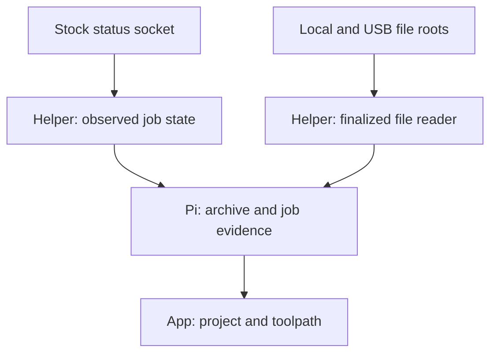

# Where the companion features connect to stock firmware

Static investigation recorded 18 October 2026 UTC / 17 October in America/Chicago. Baseline: signature-verified stock **02.01.01.07**. Compared vendor source at **5a2ea7fc03e707552701b1a69f463699cbd39230** with the actual printer and camera-host executables extracted from that rootfs. The public source is an older reference, not an asserted rebuild of the shipping image. No firmware was executed, printer contacted, or startup file installed.

**The strongest first placement is an external native helper connected to `/tmp/elegoo_uds`, plus narrowly scoped readers of the printer's user-data files.** The Pi owns archives, project associations and policy. A small separately named procd service starts the helper. Most proposed features can use those existing boundaries without replacing the vendor executable or changing its WAN strategy.

The current [starter](../../../tools/research/PI-COMPANION-SETUP.md) still exports only identity and completed native captures. This report identifies the next integration points; it does not promote them into implemented or physically qualified capabilities.

## Source and binary placement map

Addresses below identify exact functions in the pinned image, not patch offsets to reuse on another build. Printer and camera binaries have separate address spaces. Source links pin the older public commit; binary evidence is recorded independently in [COMPANION-PLACEMENTS.json](access/evidence/COMPANION-PLACEMENTS.json).

| Feature | Existing firmware site | Placement in our design | Main qualification |
|---|---|---|---|
| Running file and progress | `VirtualSD::get_status` **0x4b96d0**, `_load_file` **0x4c22c8**, `work_handler` **0x4c2d68** | Helper reads the advertised `virtual_sdcard` status object; separate file reader exports exact bytes | Relative path, source containment, same-name replacement and real job binding |
| Job lifecycle and history | `PrintStats::get_status` **0x4a5114**, `note_start` **0x4a4274**, `note_finish` **0x4a6140**; DeviceStatus/RecordManager task functions | Helper emits observed state transitions; Pi assembles a durable job journal | Missing transitions, reconnects, local versus cloud task identity |
| Telemetry | `QueryStatusHelper::handle_list` **0x2da5f4**, `do_query` **0x2db580**, `handle_query` **0x2dd0cc**; `extras::getStatus` **0x4fefd0** | One bounded UDS client, then a Pi broker serves the app | Runtime discovery, response schema, delta handling and printer resource usage |
| G-code and USB files | Active `[virtual_sdcard] path=/opt/usr/gcode`; init links `udisk` to `/mnt/exUDISK` | Read-only file roots `local` and separately resolved USB root; opaque file IDs and ranges | Finalization, symlink containment, removable media, active-print I/O |
| Thumbnails | `GcodeParser::get_thumbnail` **0x8eaf3c**, RecordManager local/USB thumbnail functions **0x8f1f50 / 0x8f20c8** | Parse an archived G-code's embedded thumbnail on Pi first; use consistent exported records as a later fallback | Actual thumbnail format, image limits and content identity |
| Pictures and finished timelapses | Camera `TimeLapseVideo::Composite` **0x18e324**; RecordManager finish association **0x8ed820** | Watch named media roots; transfer completed artifacts to Pi and associate with evidence | `.mp4` creation is not encoding completion; pictures can be removed after composition |
| Diagnostics | Logger **0x8685e0**, `/opt/usr/logs/`; camera monitor **0xea324** and frame watchdog **0x146990** | Rotation-aware bounded log tailer and an external incident journal | Live file names/log level, loss/rotation and private-data redaction |
| Configuration history | `PrinterConfig::get_status` **0x143508**, `cmd_SAVE_CONFIG` **0x143aa0**; stock launcher selects main/autosave files | Pi stores allowlisted backups/diffs; helper reads known files and selected warning flags | Autosave rename races; configuration writes are a separate qualified operation |
| Boot and replug | Stock procd support, S95 printer service and tty hotplug dispatch | Optional separately named `link-companion` service after vendor startup | Persistent overlay, paired USB route, bounded retries, boot with Pi absent |
| Managed USB storage | Block hotplug mounts FAT/exFAT/NTFS at `/mnt/exUDISK` and enumerates `sd*` devices | Pi-side virtual storage volume, optionally combined with serial after testing | Safe detach/update/re-present; neither shared live image writes nor storage autorun |

## 1. The live-toolpath connection is more concrete now

The [VirtualSD source](https://github.com/elegooofficial/CentauriCarbon2/blob/5a2ea7fc03e707552701b1a69f463699cbd39230/elegoo/extras/virtual_sdcard.cpp#L738) exposes `file_path`, `progress`, `is_active`, `file_position`, `file_size` and `power_outage`. The actual stock `get_status` references those same six keys and calls its own path/progress/activity functions. Its status dispatcher calls both VirtualSD and PrintStats getters. This is stronger than finding unused function names in an ELF.

The source `_load_file` constructs a filename beneath `sdcard_dirname`, opens it, determines its size, stores `current_file_name`, and updates PrintStats. The shipping function calls the C++ input-file stream constructor, seek/tell routines and `PrintStats::set_current_file`; its corresponding open-file diagnostic is also present. The shipping main configuration sets the base to `/opt/usr/gcode`, and stock initialization creates the `udisk` symlink to `/mnt/exUDISK`.

**`file_path()` returns the stored selected name; it is not a guarantee of an absolute, canonical filesystem path.** A value such as a `local/` or `udisk/` relative name needs source-aware resolution. Do not concatenate an arbitrary returned path and open it with root privileges. Treat internal and USB storage as separately allowlisted roots; resolve the intended USB mount deliberately, then refuse symlink escapes within each exposed root.

Proposed data flow:

The helper would first discover advertised objects, qualify a one-shot read while idle, and only then subscribe to selected fields. That preserves the existing fixed native inventory probe as its own earlier stage. The current USB exporter has no object-query command and no live console forwarding; those need a versioned protocol addition.

For example, after discovery and schema qualification, the intended object selection is `virtual_sdcard` fields `file_path`, `file_position`, `file_size`, `progress`, `is_active`, and `print_stats` fields `filename`, `state`, `message`, `info`, `print_duration`. This is an implementation contract, not a command to send blindly to an unknown printer.

The companion should open its own read-only file handle, verify metadata before/after transfer, compute SHA-256, and retain that version on the Pi. A byte offset can then locate the corresponding region in the archived G-code. **That position describes G-code consumption/dispatch, not a guaranteed physical nozzle position**: motion buffering and macros can separate the two.

Filename and size alone do not prove the archived bytes are the bytes held by the printing process. Same-name overwrite/replacement needs explicit qualification. A later owner-only diagnostic could correlate a candidate's inode with the printer's open-file descriptors, but no such `/proc` observer or descriptor-reading behavior is implemented here. Reconnect gaps and unobserved same-file restarts must invalidate strong job association until additional evidence arrives.

## 2. Use the existing status service for events

The [webhook implementation](https://github.com/elegooofficial/CentauriCarbon2/blob/5a2ea7fc03e707552701b1a69f463699cbd39230/elegoo/webhooks.cpp#L907) registers `objects/list`, `objects/query` and `objects/subscribe`. In the shipping image, `handle_list` includes `virtual_sdcard` and `print_stats` among its candidate names; `do_query` calls `extras::getStatus`, and that dispatcher directly calls the two actual getters above. Actual object instances and successful responses still require hardware observation.

The source subscription path builds an initial snapshot and subsequent changed-field messages with `params.eventtime` and `params.status`. It uses the caller's response template and stores the subscription by client connection. The actual binary references the same envelope fields. Maintain a baseline on the Pi, merge deltas, and reset that baseline on reconnect. Choose a small set of objects/fields; do not request every configuration/sensor object by default.

The source has a half-second subscription refresh constant. That is an older-source fact, not a measured guarantee for every installed binary. A Pi broker can reduce phone update frequency independently; do not assume a `frequency` parameter exists in the stock API.

`PrintStats::note_start`, pause and finish emit **`elegoo:print_stats`**, and reset uses an internal SignalManager as well. These are process-local C++ callbacks. A separately running shell/Pi process cannot subscribe by that signal name. `objects/subscribe` is the usable existing IPC boundary. Internal callback registration would require compiled code inside the vendor process.

Shipping PrintStats also references fields missing from the older published getter, including `machine_status`, `machine_sub_status`, `print_progress` and `print_time_remaining`. Treat them as discovered candidates until the live response confirms availability/types. Keep file byte progress and printer-reported progress distinct.

## 3. Archive finalized files rather than intercept downloads

The shipping `HTTPClient::download_file` worker at **0x8022b0** references `.download`, size/MD5 checks and calls `rename`. The first useful hook is an external watcher of the resulting directory: ignore staging names; consider a moved-in/finalized file a candidate, verify it, then copy and hash it through an independent handle. A directory event is a notification, not proof that no future writer can change the file. Verify identity and stability during capture and retain uncertainty on any mismatch.

This location covers a cloud download after its authenticated native worker completes, without capturing TLS traffic or altering that worker. Local/USB starts can use the same archive interface even when no cloud URL exists.

Do not put this reader inside `HTTPServer::handle_file_download` **0x84dee0**. That handler retains the busy-state guard and changes transfer-related device status; the network server's availability is also mode-dependent. A small local file reader should avoid invoking that path rather than editing its branch.

Use bounded range reads, resumable offsets, a small concurrent-transfer limit and measured throttling. The initial four-MiB capture exporter is not a general G-code/video transfer engine. Larger arbitrary files require a separate bounded protocol capability, not lifting every existing quota.

## 4. Project history belongs on the Pi

The shipping `DeviceStatus::add_task` **0x891734** references a generated UUID, filename, progress/layer/time data and a pending cloud `print_task_id`. `save_task` **0x8921a0** calls `get_task_iot_json` and `RecordManager::add_task`; the task JSON builder **0x886c1c** references `task_id`, `task_name`, begin/end times, status and `print_task_id`. RecordManager's `add_task` **0x8ed180** calls database add/update functions and contains an oldest-record removal path.

These functions establish where history is generated and why retaining an independent archive is useful. They are **not callable exported methods just because symbols exist**, and this pass does not establish that a local status response exposes the active UUID/cloud task ID. Use observed lifecycle/session identities provisionally, then correlate a consistent exported history record where available. Do not fabricate a cloud task ID for a local job.

Keep the project UUID and source CAD/STL/3MF associations in the app/Pi. The printer's G-code filename cannot reconstruct original modeling files or design intent. The Pi project manifest can link content hashes, observed sessions, finalized pictures, video and diagnostic excerpts without altering vendor records.

The existing database's `unix-none` behavior still blocks assuming ordinary live SQLite locking/backup semantics. Do not place a live SQL polling client here. Begin with consistent idle exports and the already implemented offline inspector.

## 5. Thumbnails have a useful direct-file route

`GcodeParser::get_thumbnail` **0x8eaf3c** recognizes `; thumbnail begin`, width/height/count metadata and `; thumbnail end`. `RecordManager::get_udisk_thumbnail_by_filename` **0x8f20c8** calls that parser, while its local thumbnail getter is a separate record/cache path.

That makes an embedded-thumbnail parser on the Pi a strong first implementation: it can parse the **same archived G-code** used by the toolpath, with limits on header scan bytes, encoded/decoded length, pixel count and format. No direct call into the printer's C++ parser is needed. The exact supported encodings must be checked against representative files; comment markers alone do not prove every slicer image variant works. Method 1045 or a consistent exported thumbnail record remains a fallback for files without usable embedded images. `/opt/usr/gcode_img` is not established as a complete thumbnail library.

## 6. Media completion and camera diagnostics need separate handling

The [timelapse compositor](https://github.com/elegooofficial/CentauriCarbon2/blob/5a2ea7fc03e707552701b1a69f463699cbd39230/elegoo/extras/ai_camera/module/util/time_lapse_control.cpp#L93) chooses its `.mp4` output path **before** calling `encode_from_directory`. The shipping compositor **0x18e324** calls that encoder and contains cleanup paths for its picture directory. Therefore an appearing `.mp4` is not a completed video, and source pictures may be removed after composition. Watch completed writes and qualify a completion/quiet-state policy; archive selected completed pictures before their observed retention deadline. Stock `RecordManager::update_task_delay_video_status_finish` **0x8ed820** is another correlation site, not an automatic externally callable completion API.

A new source/binary difference matters for camera diagnosis: older `Control::CameraStatusMonitor` checks **`/dev/video0`**, while the verified shipping camera-host function **0xea324** references **`/dev/video1`**. Do not declare the owner's camera missing from a hardcoded video0 check. Inventory actual devices and observe this installed build's behavior first.

The camera socket also differs from a general event bus. The source has two client slots and broadcasts through `sendMsg`; the actual binary confirms two server loops and two ClientConnection sends. Slot availability and fanout interactions are not qualified. Logs are the lower-coupling first observer; attaching a new camera-socket client needs separate testing so it does not consume a slot required by stock components or stall delivery.

Do not infer a current send bug solely from the older source. Its send method is one-shot, but the shipping method **0x152140** loops over partial sends, retries interruption, and sets send flag **0x4000** (`MSG_NOSIGNAL` on this Linux ABI). Selected instructions are included in evidence. This pass therefore does **not** recommend replacing it with a source-based short-write fix.

The shipping frame watchdog already calls restart/reopen functions, and WAN startup **0x81d644** calls `stop_local_video_monitor`. The right initial placements are bounded camera-log analysis and finalized-media reads. A concurrent LAN/cloud live-video policy change remains a separate investigation; file access does not remove that strategy decision or repair an affected camera module's own flash defect.

## 7. Put configuration policy outside the vendor process

The active stock launcher selects `/opt/inst/printer_dsp.cfg`, `/opt/usr/cfg/autosave.cfg` and `/tmp/elegoo_uds`. Back up those specific configuration inputs and qualify related includes; do not export all of `/opt/usr/cfg`, `/opt/usr/account`, `/opt/usr/cert` or `/opt/usr/wifi` as a convenience bundle.

`PrinterConfig::get_status` exposes warnings, pending-save state and raw configuration/settings. Initially request only qualified diagnostic fields; a full raw config dump is not necessary for normal telemetry. `cmd_SAVE_CONFIG` **0x143aa0** performs a G-code `M400`, constructs `_temp.cfg` / `_backup.cfg` names and renames files. It is an action, not a passive backup request. A watcher must follow path/inode replacement, not hold one autosave file descriptor indefinitely and assume it stays current.

Later named maintenance recipes belong on the Pi: compatibility manifest, explicit operating conditions, narrowly scoped backup/diff, deliberate write, health check and rollback. The printer helper exposes only authenticated, separately enabled operations. It must not accept arbitrary shell strings from the initial unauthenticated USB export protocol.

## 8. Startup and managed USB storage are different placements

Use the separately named procd service already supplied by the starter after hardware qualification. Keep the helper/state under its own `/opt/usr/cc2-companion` directory; keep archives/policy on the Pi. Do not add sleeps to the vendor S95 service or rewrite `run_printer.sh`. The real stock update path schedules `rootfs_data` cleanup, so overlay startup hooks are update-disposable even if UDISK data survives. A new image must be requalified; an unchanged executable hash alone does not authenticate the entire updated firmware.

For managed USB storage, the concrete stock site is **block** hotplug, not tty shell startup. The mount script accepts `sd*` block devices and mounts supported filesystems at `/mnt/exUDISK`; init's `udisk` symlink puts that mount within the printer's configured G-code namespace. Begin with a conventional tested FAT volume/layout. A Pi storage gadget can supply files through that normal path without a printer-shell agent, but cannot reveal unrelated internal files or create owner access. No generic arbitrary-script storage autorun was found.

The Pi's virtual disk requires exclusive backing-image ownership and safe detach/update/re-present, with any printer reads/writes finished first. The current starter owns the gadget controller through `g_serial`; adding storage requires a tested replacement composite-gadget configuration, not loading a competing gadget onto the same controller. USB Ethernet is not the stock-supported shortcut here: the inspected host kernel lacks USB network drivers.

## What would require rebuilding or patching firmware

If we deliberately chose a vendor-process fork, the natural source sites would be `_load_file` immediately after successful selection for file identity, PrintStats transitions for lifecycle events, the compositor after successful encoding for media completion, and the config save path for change history. Those placements are source modification ideas, not installed hooks.

The [object loader](https://github.com/elegooofficial/CentauriCarbon2/blob/5a2ea7fc03e707552701b1a69f463699cbd39230/elegoo/printer.cpp#L126) calls the compiled `ExtrasFactory::create_extras` dispatch chain. In this examined path, the README's extension-module description does not establish drop-in native plugins or a Python loader. Adding a factory entry would be a rebuild. Network/record `communication/` and `api_module/` source paths are absent from the pinned published tree, while CMake refers to `turbo_core`; the current implementations above were traced from the shipping binary. A complete matching rebuild is not established by the public source alone.

That makes the external UDS/filesystem/helper service the most practical stock-preserving placement. It keeps most version sensitivity in a small compatibility adapter and leaves project processing on the Pi.

## Implementation order

1. **Qualify object discovery and one idle snapshot**, after the existing fixed inventory probe. Save the actual schema privately. No recurring requests until the methods/fields and failure behavior have been observed.
2. **Implement the read-only status adapter** with one UDS connection, bounded framing, selected fields and baseline/delta handling. Carry observations through a new capability, not arbitrary raw console forwarding.
3. **Implement one finalized G-code range reader**, first while idle. Pin source identity, hash the archive and make ambiguous job association visible. Measure an expendable active-print read separately before enabling that case.
4. **Add Pi-side embedded thumbnails and project manifests** from those exact archived bytes. Link original source models from app uploads.
5. **Add rotation-aware log tails and finalized media** with per-root quotas. Keep live database and camera-socket control out of this first expansion.
6. **Qualify the existing optional boot hook**, both boot orders, disconnect/replug, Pi absence and an explicit recovery path. Add authenticated named maintenance recipes only after observation, compatibility and recovery are dependable.

Reproduction: use Python 3.10+ with the baseline's PySquashfsImage 0.9.0, pyelftools and Capstone dependencies, plus host `git` and `c++filt`. Run `access/tools/map_companion_placements.py --rootfs VERIFIED_ROOTFS --source PINNED_VENDOR_CHECKOUT --output NEW_REPORT.json`. It verifies the rootfs and both ELF hashes, compares all 11 selected source files to the pinned Git objects, checks the full tracked tree for the omitted source directories, and reads seven selected image files. Its 36 function records contain direct calls and selected literals; indirect dispatch, live object existence, protocol acceptance, printer resource usage and hardware operation remain explicit qualification steps.

Validation: regenerated the evidence byte-for-byte, cross-checked available function names/literals against the existing address-based tracer, parsed the tool with Python AST, checked report links and Git whitespace, and verified that unexpected rootfs/source inputs are refused before output creation. Evidence SHA-256: `b81456794da625aa6971973918fa43478d8197d9cf7dcf0f0eee77a90ad42350`. No production app/agent code changed, so this pass does not replace the starter's prior CI qualification or require another ARM build.
