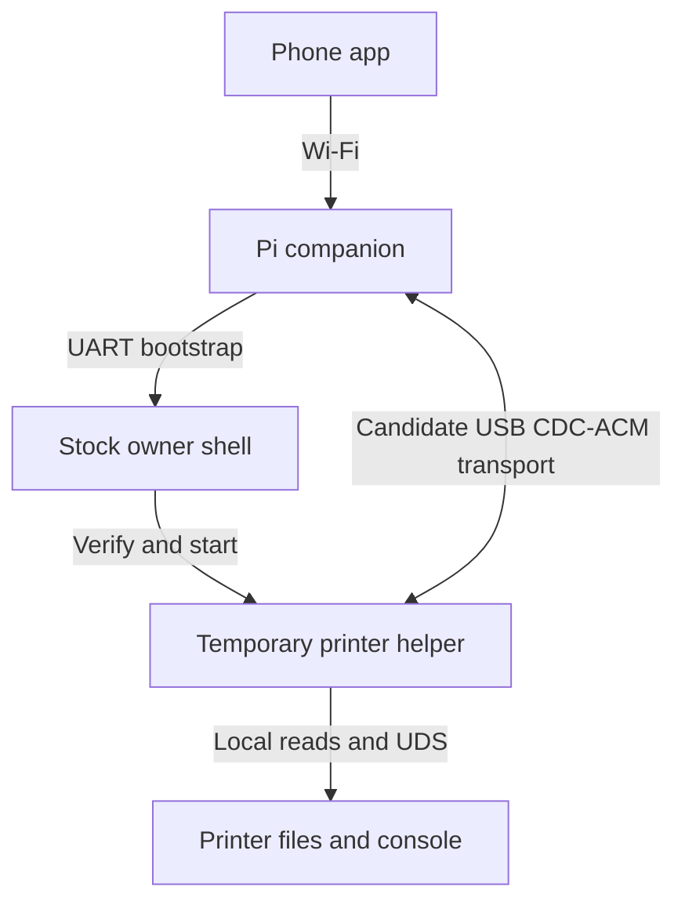

# A persistent Pi companion for the stock CC2

Checked 17 October 2026 against the signature-verified **02.01.01.07** package. This pass re-downloaded the pinned package, verified all three vendor RSA/hash layers, read the rootfs and embedded kernel configuration, and inspected startup/hotplug/update scripts. No firmware was executed, no printer was contacted and no hook was installed. The owner's exact installed version, live mount state, shell privilege and physical connections remain unverified.

**A permanently attached Pi is a credible direction. The stock kernel has a particularly useful USB capability: a Pi presenting CDC-ACM serial can potentially communicate with it. That does not automatically provide a Linux shell. The most update-tolerant design keeps recovery and policy on the Pi, retains UART as the bootstrap path, and treats any printer-side startup hook as disposable.**

## What the actual image supports

| Capability | Image evidence | Practical consequence |
|---|---|---|
| USB host CDC-ACM | `CONFIG_USB_ACM=y` | A Pi serial gadget is a suitable candidate for the printer's normal USB host port. Expect a printer-side `ttyACM` device only after hardware enumeration is qualified. |
| Conventional USB serial adapters on the printer | `CONFIG_USB_SERIAL` is not set | Do not assume an FTDI/CP210x/CH340 adapter plugged into the printer will work. This does not prevent using those adapters on the phone/Pi host side. |
| USB Ethernet adapters on the printer | `CONFIG_USB_NET_DRIVERS` is not set; no corresponding network modules in the inventory | Pi Ethernet-gadget recipes are not a stock-supported shortcut here. Printer-side gadget RNDIS support is the opposite USB role. |
| USB keyboard | Host `CONFIG_USB_HID` and `CONFIG_INPUT_KEYBOARD` are not set | A Pi pretending to be a keyboard does not establish the existing tty1 shell. |
| USB storage | `CONFIG_USB_STORAGE=y`; block hotplug mounts supported drives at `/mnt/exUDISK` | A Pi can be considered as managed virtual USB storage, but that only exposes files on that presented volume. It does not expose the printer's internal files or shell. |
| Existing owner-console action | `/etc/inittab` configures `askfirst` on `ttyS2`, `tts/0` and `tty1` | UART remains the existing shell lead. There is no stock `ttyACM` shell entry. Earlier askfirst disassembly establishes its direct ash-launch behavior, not actual access on the owner's device. |
| Writable root overlay | `CONFIG_OVERLAY_FS=y`; fstab targets `/dev/by-name/rootfs_data` at `/overlay`; mount_root refers to rootfs_data and temporary-overlay fallback | Owner-installed startup files are plausible after access. A live mount check must distinguish persistent storage from a temporary fallback. |
| Persistent user data | `/dev/by-name/UDISK` is configured at `/opt/usr`; init waits for ext4 there | A separate companion data directory is a candidate for retained state/binaries. Merely placing a script there does not execute it. |
| Outbound SSH | Actual `/usr/bin/ssh` identifies OpenSSH 8.0p1 and includes stream-local forwarding strings; `scp` and `rsync` are present | After bootstrap, printer-initiated connections to an owner-controlled Pi are another candidate for protected file/console transport. No inbound SSH server is required for that direction. |

All selected configuration values, 23 file fingerprints/excerpts, rc links, 16 module paths and missing hook/server paths are recorded in [PI-COMPANION-HOOKS.json](access/evidence/PI-COMPANION-HOOKS.json). An enabled driver is evidence of software support, not a completed connection test.

The ordinary front USB host port is the candidate for this connection. The toolhead connector is a different electrical interface; its documented 24-V connection must not be used as a computer/Pi USB port. Physical host-port identity, available current and power arrangement need qualification. Do not infer them from connector shape.

## The two viable architectures

| Design | Printer modifications | Reboot behavior | Official-update behavior |
|---|---|---|---|
| **Pi maintains the existing UART console** | Can start with none; stage a helper in `/tmp` only when needed | Pi waits for the normal Linux console and restarts a qualified temporary helper | Pi policy survives outside the printer. Access still depends on the new stock image retaining a usable owner console; changed/unknown firmware requires fresh qualification. |
| **Pi connected through front USB CDC-ACM** | One initial owner bootstrap and a small startup/hotplug service, unless manually launched each time | Hook/service can reopen the intended USB serial device after boot/reconnect | Hook in rootfs_data can be erased by the stock update sequence. A separate recovery path is needed to restore it; USB alone cannot restore its own missing launcher. |

My preferred trajectory is a **UART bootstrap/recovery connection plus optional USB bulk transport**. The Pi keeps its own Wi-Fi connection for the phone. UART can restore a small temporary helper without depending on the printer's current network mode. USB can then carry a framed companion protocol without forcing file bytes through the physical UART link.

Candidate topology; the USB helper below is proposed, not implemented:

A Pi Zero W is sufficient as a candidate supervisor/transfer endpoint; processing and retention budgets still need measuring. A Zero 2 W offers more CPU headroom if buying a board. The existing ARMv7 native probe targets the **printer**, not the original ARMv6 Pi Zero W. Host Python tools run on the Pi separately.

Raspberry Pi's [official OTG guide](https://pip-assets.raspberrypi.com/categories/685-app-notes-guides-whitepapers/documents/RP-009276-WP-1-Using%20OTG%20mode%20on%20Raspberry%20Pi%20SBCs) documents serial, storage and composite gadgets on the Zero family's USB data port. In serial mode the Pi side uses a gadget TTY and the Linux host can expose `ttyACM`. Its sole data port cannot simultaneously be used as a normal USB host for a USB UART dongle; direct GPIO UART is the natural companion bootstrap connection in that arrangement.

Pi GPIO UART uses 3.3-V signals. The printer header level is still unresolved; direct wiring requires a verified match or an appropriate level translator. Disable the Pi's own login console on the UART reserved for controlling the printer and qualify its UART clock/Bluetooth configuration. See [official UART configuration](https://www.raspberrypi.com/documentation/computers/configuration.html#configure-uarts). Do not connect the two systems' UART power pins. Power from the printer and separate Pi power each need a validated arrangement; avoid assuming that a front port can reliably power the Pi or that two 5-V sources can be tied together.

## Which hooks exist, and what planting one would mean

### Boot service: the clearest printer-side candidate

The configured boot chain is `inittab` → procd's S-series service dispatch → `/etc/rc.d/S94done` → `/etc/init.d/done`, which executes `/etc/rc.local`. The printer service follows at S95. The actual procd binary contains the sysinit/rcS-dispatch and `/etc/rc.d` strings; a literal `/etc/init.d/rcS` file is absent, so that inittab text should not be mistaken for a separate script to edit. `rc.local` already invokes `init_dir.sh` and time synchronization. Its debug installer line is commented and `/etc/install.sh` is absent.

After owner access, a separately named OpenWrt/procd service is a cleaner candidate than rewriting the vendor printer launcher. `/etc/rc.common` includes its `USE_PROCD` service path. A hypothetical `/etc/init.d/link-companion` would start a bounded process without blocking printer startup, wait independently for the intended USB device, and reconnect without restarting `elegoo_printer`. Installation into the writable overlay changes persistent printer configuration even though the signed firmware image and vendor executable remain intact. That distinction should remain explicit.

This pass deliberately supplies an observation worksheet rather than an installer. The live root overlay has not been checked and a USB agent has not been implemented or tested. A script that blocks waiting for the Pi in the boot sequence would be an avoidable failure mode.

### Device arrival: suitable for reconnect notification

`/etc/hotplug.json` dispatches tty events through `/sbin/hotplug-call`. That program sources scripts from `/etc/hotplug.d/<subsystem>`. There is **no `/etc/hotplug.d/tty` directory in the pinned image**. Creating an owner-controlled handler there is a candidate hook, not a pre-existing autorun facility.

udevd also starts at S85. Its bundled persistent-serial rules recognize `ttyACM` and create by-path/by-id links when the relevant identity properties exist. A future service should match the paired Pi rather than assume the first `ttyACM0` always belongs to it. USB IDs identify a device for routing; pair authentication is separate. Since two event mechanisms are present, actual event delivery, boot-already-attached behavior and unplug/replug must be observed before selecting one. Keep hotplug callbacks short; let the supervised process manage the connection and enforce a single instance.

Creating a raw unrestricted ash shell on every new USB serial port would skip the application boundary we need. A small authenticated agent can expose named file/status/maintenance operations while keeping arbitrary shell work as an explicit owner maintenance mode.

### Storage insertion: no general script autorun found

The actual `/etc/hotplug.d/block/10-mount` script mounts supported storage and contains a specific factory/theme-selection path. It does not execute arbitrary scripts from an inserted USB drive. The `S99swupdate_autorun` service invokes the stock firmware updater; its name is not evidence that a Pi can present an arbitrary startup script. Neither is a generic companion bootstrap.

A Pi storage gadget has a separate useful role: retain the exact G-code that it presents for USB-started jobs, giving the app a known file source before printing. That still does not establish exact current-job binding or reveal internal/cloud-started files. Use an image owned by one side at a time. The [kernel's mass-storage documentation](https://docs.kernel.org/usb/mass-storage.html) warns against modifying its backing file concurrently while the host uses it; a live shared FAT image is not a synchronized network filesystem.

### Printer configuration and macros are a separate layer

The pinned `run_printer.sh` actively starts `/opt/inst/printer_dsp.cfg`, with `/opt/usr/cfg/autosave.cfg` supplied separately. Its alternative user-main-config branch is commented out. G-code macros should not be promoted into an assumed Linux startup/shell hook. The vendor's public source was also checked at `5a2ea7fc03e707552701b1a69f463699cbd39230` as a reference; its macro path dispatches G-code and does not establish an installed `RUN_SHELL_COMMAND` extension. That source release is not asserted identical to this September stock binary.

## The important update limitation

The signed SWU description writes the alternate A/B kernel and rootfs slots and changes the next boot selection. It also sets `swu_next` to reboot. The stock `swupdate_cmd.sh` responds by setting **`parts_clean` to `rootfs_data`**. During the next preinit, `79_format_partition` consumes that list, clears the selected partition's filesystem header area, and formats it when needed.

This is direct evidence that the normal updater path is designed to discard root-overlay modifications. A boot service, rc.local edit or udev/hotplug hook there should be treated as **reboot-persistent but update-disposable**. This cleanup setting does not name UDISK; the pinned SWU description does not include a UDISK image. That supports keeping companion state separately at `/opt/usr`, but does not guarantee survival across all future updates, resets or recovery procedures. Surviving data is not the same as a surviving executable launcher.

Do not preserve an entire old overlay across a new official rootfs merely to keep a hook: it can also preserve stale scripts/libraries that mask updated vendor files. Keeping a tiny reinstallable launcher and the compatibility policy on the Pi is easier to audit.

With permanent UART, the Pi can *potentially* restore a qualified helper after an official update while leaving the new signed image intact. It should first recognize a normal Linux activation prompt, establish shell UID, read the installed executable fingerprint and inspect mount/service state. An unknown fingerprint goes to observation only. It must never send recovery commands to the bootloader, change boot selection or blindly reapply a previous firmware's tweaks. Future stock firmware may close the owner-console route; this architecture is not a guarantee against that change.

## A useful alternative to building a new network server

The actual image contains an **outbound OpenSSH 8.0p1 client**, plus `scp` and `rsync`. The client includes direct/forwarded stream-local support strings. After owner bootstrap, a printer-initiated, key-authenticated connection to a dedicated Pi account is worth qualifying for file export or a private forwarded endpoint. The Pi would host the SSH server; the printer would not need an inbound SSH daemon or a LAN-mode switch.

OpenSSH documents [remote forwarding to Unix-domain sockets](https://man.openbsd.org/ssh.1#R) and [server forwarding permissions](https://man.openbsd.org/sshd_config#AllowStreamLocalForwarding). An actual stock-client/Pi-server handshake, exact option compatibility, host-key checks, resource usage and WAN coexistence have not been tested. A forwarded raw console should remain private to the Pi's broker, which applies the existing method gates. This is a candidate protected transport after access, not a new way to obtain initial access.

## What the companion would manage

Keep persistent policy, release manifests, archives, logs and the user-facing authenticated API on the Pi. Keep printer-side code small and replaceable:

- Start the verified helper only after normal boot, fingerprint and service-readiness checks; stop cleanly when its transport fails. The printer must boot and print normally with the Pi absent.
- Expose finalized G-code/media file reads from a bounded allowlist. Preserve size/hash/job-source metadata and distinguish a chosen copy from an independently verified live-file match.
- Subscribe to already qualified UDS events for console/status; use inotify for finalized-file observations where useful (`CONFIG_INOTIFY_USER=y`), with bounded queues and rescan after overflow.
- Maintain logs/thumbnail archives on the Pi, with explicit storage limits. Do not copy the live SQLite main file as though it were a consistent export; retain the existing database-export requirements.
- Represent tweaks as named, version-scoped changes with expected-before content hashes, an applied-change record, reversible backups and a disable path. Helper launch/log collection is a suitable first recipe. Camera resets, motion/heater changes and native LAN/WAN strategy changes need their own qualification.

At physical UART 115200 8N1, the ideal raw payload ceiling is about 11.5 kB/s: a 50-MiB file takes roughly **76 minutes** before framing/encoding overhead. UART is therefore useful for control/bootstrap and small logs, but a poor bulk-file path. USB CDC-ACM avoids carrying those bytes over that physical UART; actual USB throughput and coexistence still need measurement. Outbound SSH on the existing Wi-Fi is another bulk-transfer candidate.

## Concrete next acceptance work

1. Establish the existing owner console using the [phone/UART sequence](PHONE-UART-NEXT-STEPS.md); record the actual version, header/levels, prompt and UID.
2. Run [collect-companion-facts.sh](access/tools/collect-companion-facts.sh) in that idle owner shell. It reads fingerprints, selected mounts/kernel flags and USB/tty metadata without opening serial ports, loading drivers, changing configuration or reading credentials.
3. Configure a Pi Zero serial gadget using the official guide. Qualify the power arrangement and plug its data port into the printer's normal USB host port. Observe enumeration and the correct CDC-ACM TTY. This does not yet launch a printer shell.
4. Start a temporary native helper manually through the established console. First qualify one fixed inventory request using the existing probe, then implement/test the framed USB transport separately. No persistent printer hook is needed for this initial stage.
5. Choose between a Pi UART supervisor and an explicit small printer-side procd service. Test Pi absent, either boot order, reconnect, idle recovery and bounded transfer before considering active-print reads or automatic tweaks.
6. Qualify an official update as a distinct acceptance test: preserve owner data externally, record overlay/hook loss, establish access on the new image and re-enable only compatible recipes. No official update was performed by this analysis.

Offline reproduction: after unpacking the pinned image as in [baseline/README.md](baseline/README.md), run [inspect_companion_hooks.py](access/tools/inspect_companion_hooks.py) with its `--rootfs`, `--kernel`, `--sw-description` and new `--output` paths. It rejects unexpected image/configuration hashes and reproduces the committed evidence. The unpacker's kernel extraction needs the kernel CPIO member in addition to its original rootfs/sw-description selection. The owner worksheet was checked with `sh -n`; neither worksheet nor a proposed service has run on a physical printer.
