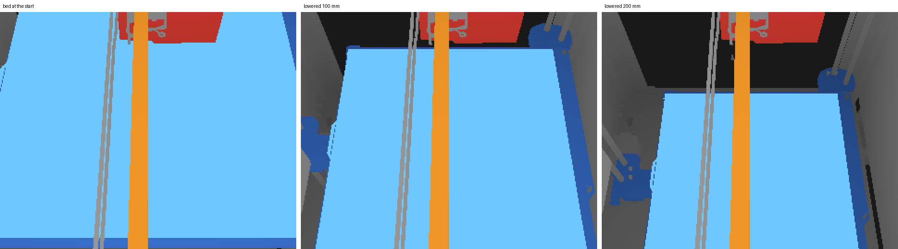

# CC2 hood riser with a FLIR A65 thermal camera

> The CC2's lid is a smoked-plastic hood about 300 mm tall. The community model has only its base ring, which is all
> the riser needs: the ring drops into the riser's top as it drops into the frame now. The model leaves out the hood's
> clear walls, which are opaque to the camera; they rise above the riser and never block its view.

A riser for the Elegoo Centauri Carbon 2's hood, with a pod on its left wall for a FLIR A65 thermal camera (45° lens),
placed by a study of what the camera can see of the bed as the printer moves. The app reads the camera over GigE Vision
(Settings → Cameras → Add a camera → Thermal camera).


## What it is

- **The riser** sits where the hood sits now. Its lower edge (the plug) drops inside the frame's top lip onto the ledge.
  Its body rests on the lip. Its top repeats the frame's lip and ledge, so the hood's base ring drops into it, raised by 206 mm.
- **The camera pod** is a sleeve that holds the front of the camera. It passes through a cut-out in the left wall.
  - The lens sits 5 mm inside the riser, so no line of sight to the bed crosses the wall.
  - The camera's body stays outside in room air. The A65 is rated to 50 °C.
  - Nothing may cover the lens: glass and clear plastic block long-wave infrared.
- **Position:** the lens is centred front to back (in line with the bed's centre), 100 mm above the hood ring's old top edge,
  tilted 61° down.

What the camera sees with the riser and pod in place (`verify.py`):

| | |
|---|---|
| Bed seen, with the bed at the start of a print (the head and gantry are closest) | 55 % |
| Bed seen, on average across a print | 77 % |
| Size of one camera pixel on the bed | about 0.6 mm |
| Clearance between the head's tall parts (the CANVAS multiplexer) and the pod, at the head's leftmost travel | 24.5 mm |
| Gap between the pod and the raised hood's base ring | 5.4 mm |



*Light blue is the bed's top surface, orange the gantry, red the head, grey the frame. The three views show the bed at the
start, lowered 100 mm and lowered 200 mm.*

## Measure before printing

Every printer dimension comes from the **OpenCentauri community CAD model** of the CC2. Its frame is Elegoo's; the rest
was modelled by contributors. Check these on your printer and change them at the top of `riser.py`:

| Setting | Model value | What it is |
|---|---|---|
| `FRAME_X`, `FRAME_Y` | 200, 203 | Half the outer width and depth of the top frame |
| `LIP_T` | 3.5 | Thickness of the frame's outer top lip |
| `LIP_TOP − LEDGE` | 35.3 | Depth from the lip's top down to the ledge the hood's ring sits on |
| `LIP_TOP − RING_BOTTOM` | 38.3 | How far the hood's base ring hangs below the lip's top (it reaches about 35 mm in from the wall) |
| `LENS_R` | 16 | Radius of the A65 lens's front, plus `FIT` clearance |
| `CAM_W`, `CAM_H` | 40, 43 | The camera's width and height (datasheet), plus `FIT` |

Also check:
- **The hood's corners.** They may be rounded where the walls meet.
- **The ¼"-20 thread.** Check it lines up with the pod's slot, which runs along the camera's base.

## Printing

All pieces fit the CC2's 256 mm bed.

| Part | Copies | Notes |
|---|---|---|
| `print/front-1`, `front-2`, `back-1`, `back-2` | 1 each | 200 × 247 mm, lie flat |
| `print/left-1` | 1 | Holds the pod cut-out and four M3 heat-set insert holes |
| `print/left-2`, `right-1`, `right-2` | 1 each | |
| `print/camera-pod` | 1 | Turn it so the flange lies on the bed; supports inside the sleeve |
| `print/splice-plate-x4` | 4 | Joins the two halves of each wall, on the inside |
| `print/corner-bracket-x4` | 4 | Joins the walls at the inside corners |

- **Material:** PETG or ASA, since the riser sits in the printer's warm air. 4 walls and 30 % infill are plenty.
- **Hardware:**
  - M3 screws and nuts for the splice plates and corner brackets.
  - 4 × M3 heat-set inserts and screws for the pod.
  - 1 × ¼"-20 screw, about 10 mm long, for the camera.

STEP files sit beside every STL, and `cc2-thermal-riser-assembly.step` has the whole assembly in place, with the
camera's outline.

## Changing it

```sh
pip install -r requirements.txt                  # cadquery, Open CASCADE (OCP), trimesh, embreex, numpy, pillow
python riser.py . 100                            # lens height above the hood ring's old edge (mm); rewrites print/ and the assembly
./fetch_model.sh                                 # the CC2 model (OpenCentauri, GPL-3.0, downloaded into build/, ~2 min)
python verify.py 100                             # clearances, coverage, images/camera-views.png
python overview.py                               # images/riser-and-pod.png
```

- **A lower riser** costs coverage. The best result at each lens height (`placement/podcheck.py`):

  | Lens height above the hood ring's old edge | Riser height | Bed seen at the start / on average |
  |---|---|---|
  | 60 mm | about 166 mm | 48 % / 64 % |
  | 85 mm | about 191 mm | 55 % / 74 % |
  | **100 mm (default)** | **206 mm** | **55 % / 77 %** |

  Above about 108 mm, the wall pieces no longer fit the bed in one piece (`riser.py` says so).
- **Another tilt** means another pod: set `TILT` and reprint `camera-pod` only.

## The placement study

`placement/` holds the study that chose the spot:
- **Candidates:** about 1,900 camera positions on the four riser walls, at several heights, tilts and aim points.
- **States:** each is checked with the bed at its start height, lowered 100 mm and lowered 200 mm, and with the head
  in five places.
- **Method:** it traces lines of sight with Embree, so the gantry and head blocking the view count.

Its result (`placement/tradeoff.py`, for a camera anywhere on the wall line):
- The left side beats the front, back and right. The CANVAS unit takes the right side.
- Coverage levels off at a lens height of about 185 mm above the hood ring's edge: 71 % at the start, 88 % on average.
- The nozzle tip can't be seen from above at all, because the head's shroud hides it.

| File | What it does |
|---|---|
| `placement.py` | The study: candidate positions, line-of-sight checks, scoring, simulated views |
| `cc2.json` | The CC2 set-up: bed, nozzle, travel, head positions, riser walls, the camera |
| `keep_step.py` | Makes a copy of a STEP assembly that keeps only the named parts, so it imports in a minute instead of hours |
| `occ_export.py` | Reads a STEP assembly with Open CASCADE and writes meshes grouped by what moves (bed, gantry, head, frame, hood ring) |
| `tree_step.py` | Prints a STEP assembly's part tree |
| `tradeoff.py`, `podcheck.py`, `recommend.py` | The tables and views above |
| `synthetic.py`, `syn.json` | A box printer, to test the study without the model |
| `further.py` | A smaller riser with the camera further out on an arm: it never beats a camera at the wall line |

## Credits

- **The CC2 model:** [OpenCentauri/cad](https://github.com/OpenCentauri/cad) (GPL-3.0). It is not included here;
  `fetch_model.sh` downloads it.
- **FLIR A65 size and mounting:** FLIR's datasheet.
